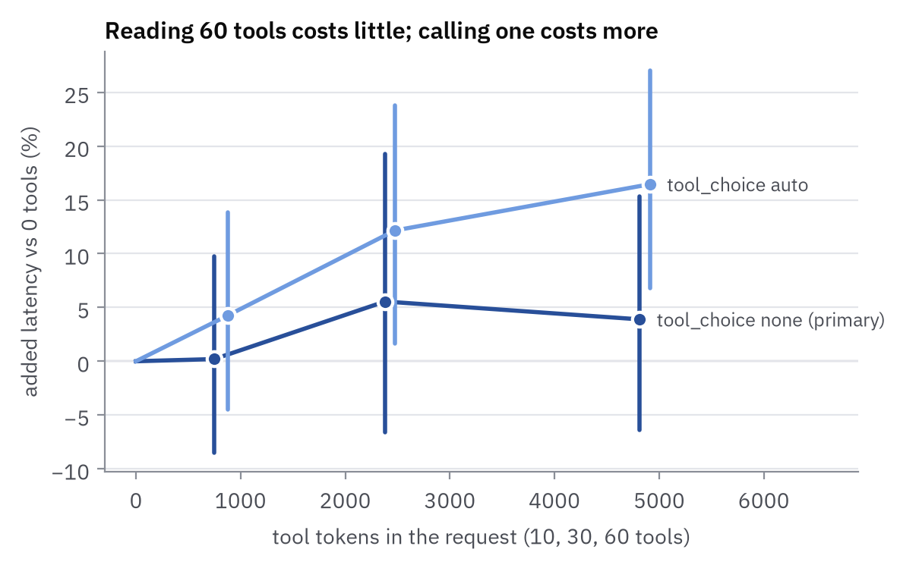
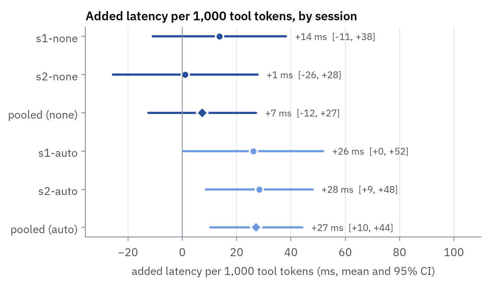
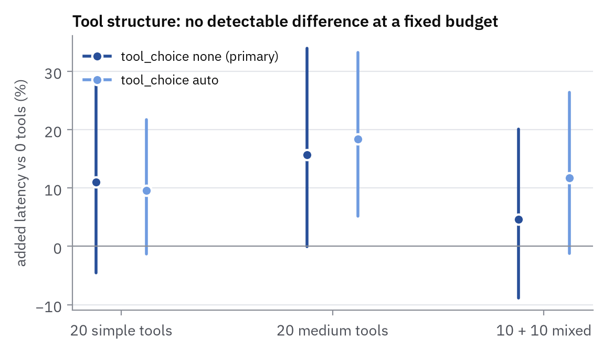
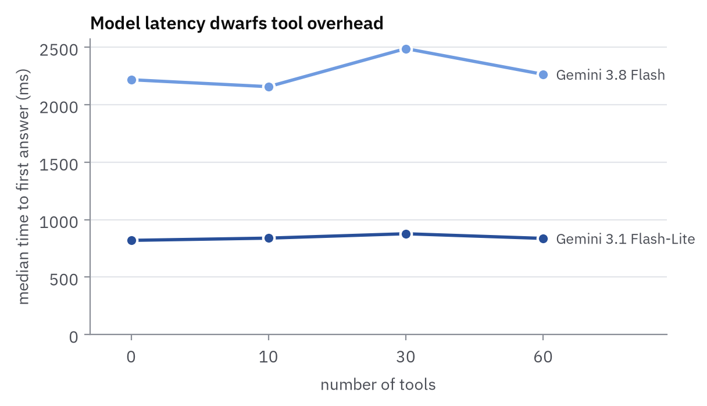
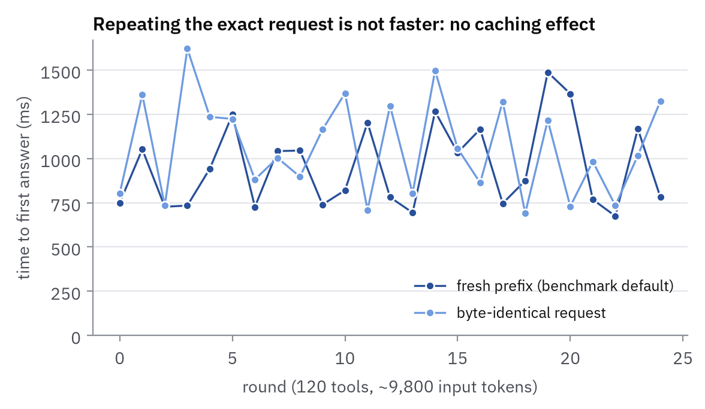

# Findings: Gemini, November 2026

First real-provider results of tool-latency-bench, run on 6 November 2026 against Google's Gemini
API (OpenAI-compatible endpoint, paid tier). All intervals are 95%. Estimates use the repo's own
estimators (`tool_latency_bench.analysis`); "pooled" means the complete blocks of both sessions
analyzed together, still clustered on the user message.

Also as PDFs: a [2-page summary](summary.pdf), a [full report](report.pdf) covering the tool
corpus, design, statistics, results and checks, and [10 slides](slides.pdf).

**Summary.** On Gemini 3.1 Flash-Lite, putting up to 60 tool definitions (~4,900 tokens) in a
request added no latency we could detect: at most ~130 ms, most likely ~35 ms, on an ~820 ms
response. Letting the model actually call tools added a measurable ~16% at 60 tools, mostly the
time to emit the call. How the tools were written made no detectable difference, and switching
model moved latency about 40× more than the tools did.

## Setup

| Item | Value |
|---|---|
| Main model | `gemini-3.1-flash-lite`, `reasoning_effort: none` (checked: 0 hidden thinking tokens, with and without tools) |
| Other model | `gemini-3.8-flash`, `reasoning_effort: none` (`minimal` returns HTTP 400); exp1 only, one session per mode |
| Experiments | exp1 (0 / 10 / 30 / 60 tools), exp2 (0 tools vs 20 simple / 20 medium / 10+10 mixed at a ~3,060-token budget) |
| Modes | `tool_choice none` = primary (cost of reading the tools); `auto` = secondary (realistic) |
| Sessions | Flash-Lite: 2 sessions (s1, s2) per experiment × mode, 30 blocks each, same afternoon (16:34–18:29 IST) |
| Metric | `actionable_ms`: time to first answer text, or to the completed tool call if one starts first |
| Requests | ~1,250 (960 Flash-Lite benchmark, 240 3.8 Flash, 53 caching probe) |
| Errors | Flash-Lite 0–1 per 120-request run, all "stream ended with no text or tool call"; no 429/503 |

## 1. Reading tools is cheap (exp1, `tool_choice none`)

- Baseline (0 tools) median **820 ms**.
- Pooled dose-response: **+7.4 ms per 1,000 tool tokens [−12.5, +27.2]**, or +0.9% per 1k [−1.0, +2.9].
- 60 tools (~4,875 provider tokens): **+3.9% [−6.4, +15.3]** vs 0 tools.
- The sessions agree: s1 +13.7 [−10.8, +38.2], s2 +1.1 [−25.6, +27.7] ms per 1k.
- Read as an upper bound: even at the top of the interval, 60 tools add at most ~130 ms. The
  point estimate is ~35 ms.

## 2. Letting the model call tools costs more (exp1, `tool_choice auto`)

- Pooled: **+27.2 ms per 1,000 tool tokens [+10.2, +44.2]**, +3.2% per 1k [+1.4, +4.9]. The
  sessions agree (+26.1 and +28.3).
- 60 tools: **+16.5% [+6.8, +27.0]**, median 895 → 1,080 ms.
- The model calls a tool in 58% / 87% / 93% of requests at 10 / 30 / 60 tools (3% at 0).
- At 60 tools, tool-call responses had median 1,082 ms (n=56) vs 876 ms for text answers (n=3,
  too few to rely on). Most of the gap between the modes looks like the time to emit a complete
  tool call rather than the time to read the tools. `actionable_ms` waits for the full call, so it
  is a real cost for a voice agent, but a different one from what `none` measures.

## 3. Tool structure: no detectable difference at a fixed budget (exp2)

- Pooled, `none`: simple +11.0% [−4.5, +29.0], medium +15.7% [−0.1, +34.0], mixed +4.7%
  [−8.8, +20.1] vs 0 tools.
- Contrasts: medium vs simple **+4.3% [−8.1, +18.3]**, per-1k-token rate difference
  **+9.9 ms [−48.7, +68.4]**; mixed vs simple −5.7% [−14.8, +4.3].
- `auto`: medium vs simple +8.0% [−1.4, +18.3], rate difference +27.2 ms [−16.0, +70.4].
- The sessions disagree on the sign (medium vs simple: s1 +17.9%, s2 −8.2%), which is what noise
  around zero looks like.
- **Token caveat:** the budget is matched with tiktoken, but Gemini counts the medium sets as
  **+13.8%** more tokens than the simple ones (mixed +6.9%). The per-token rate difference
  corrects for this; the plain ratios do not.
- Consistent with exp1: 20 simple tools (~3,350 tokens) +11.0% [−4.5, +29.0] here vs 30 tools
  (~2,440) +5.6% [−6.6, +19.2] and 60 tools (~4,875) +3.9% in exp1. The intervals overlap.

## 4. The model matters far more than the tools

- `gemini-3.8-flash` has a median of **~2.2 s** at every tool count vs 0.82 s for Flash-Lite. The
  gap between models (~1.4 s) is about 40× the estimated cost of 60 tools.
- 3.8 Flash cannot be measured cleanly on this endpoint: `minimal` returns HTTP 400, and `none`
  does not reliably turn thinking off when tools are present. It sometimes spends ~95 hidden
  tokens thinking, hits `max_tokens: 100` and returns `finish_reason: length` with no output
  (2/120 empty responses with `none`, 20/120 with `auto`). Its numbers mix thinking time with tool
  reading, so it is reported only as this finding, not as a tool-overhead estimate.

## 5. Checks

- **No caching effect.** 120 tools (~9,700 input tokens), 25 rounds, a byte-identical request vs a
  fresh nonce in random order each round: ratio **1.11 [0.96, 1.29]**, so repeating the exact
  request was not faster. Gemini reports no `cached_tokens`, so this probe is the evidence that
  prompt caching did not lower latency. The fresh 120-tool median (875 ms) was also close to the
  0-tool baseline.
- **Hallucinated tool calls.** For one user message ("How many reward points do I have right
  now?"), Flash-Lite returns an invented function call (`get_reward_points`,
  `get_customer_reward_points`) **with no tools declared**, in 3 of 6 retries, and also ignores
  `tool_choice: none` for it. This explains the ~3% "tool" outcomes in `none` mode. Removing that
  message changes nothing (`none` slope +7.4 → +7.4; `auto` +27.2 → +29.5 ms per 1k).
- **Order within a block.** Medians by position: 882 / 877 / 845 / 789 ms (exp1, `none`). The first
  request of a block is slower; conditions are shuffled within each block, so this adds noise but
  no bias.
- **Drift.** First-10 vs last-10 block medians: 824 vs 853 ms (exp1, `none`). Negligible.
- **Noise.** Coefficient of variation ~0.3; p10–p90 about 690–1,290 ms at every tool count. A
  single 30-block session can only detect changes of about ±20%; detecting 5% would take ~400
  blocks, which is why pooling more sessions matters.

## Limitations

- One provider, one main model, two sessions on the same afternoon.
- The OpenAI-compatible endpoint, not the native Gemini API that Pipecat's `GoogleLLMService` uses.
- Short prompts (~100 tokens before the tools) and output capped at 100 tokens.
- At most 60 tools (~4,900 tokens) in the benchmark runs; 120 only in the caching probe.

## Next steps

- More Flash-Lite sessions on other days, pooled.
- OpenAI as the second provider, and a fast-inference provider (Groq, Cerebras), where tool
  overhead may be close to zero.
- 0 / 30 / 60 / 90 / 120 tools from the existing exp1 pool (it has 121 distinct names).
- Native Gemini API vs the OpenAI-compatible endpoint (and whether `thinkingBudget: 0` makes 3.8
  Flash measurable).
- An exp2 budget matched in provider tokens, and tool-selection accuracy as the tool list grows.
